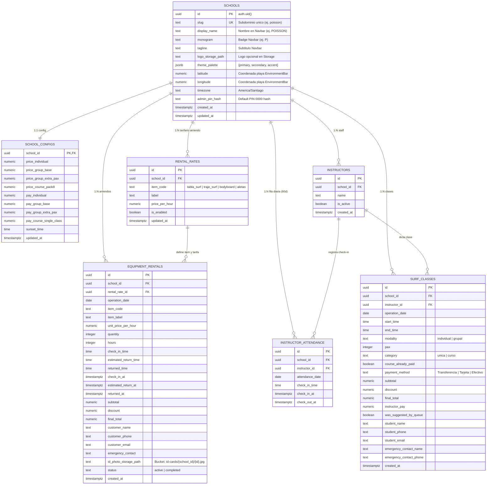

> **Nota (fix/auditoria):** este borrador quedó reemplazado por `supabase/migrations/20261109000000_surfops_schema_v2.sql`. Se conserva como referencia histórica; los nombres de columnas y reglas vigentes están en la migración y en el README.

# Diseño de Esquema Relacional PostgreSQL (Supabase) para SurfOps ERP

*   **Autor:** josealfaro7
*   **Estado:** Draft
*   **Fecha:** 2026-11-08

--------------------------------------------------------------------------------

## Overview

SurfOps ERP opera actualmente como una aplicación monolítica en el navegador donde toda la configuración financiera, la fila de asistencia de instructores, las clases agendadas y los arriendos de equipamiento viven en memoria ([SurfSchoolContext.jsx](./src/context/SurfSchoolContext.jsx)) y en claves aisladas de `localStorage` (`surfops_rental_rates`, `surfops_active_rentals`, `surfops_completed_rentals`), con la marca **`POISSON`** y la paleta de colores (`blue-950`, `sky-500`, `pink-600`) codificadas de forma fija en [App.jsx](./src/App.jsx).

Este documento define la arquitectura de base de datos relacional en **PostgreSQL sobre Supabase** para transformar SurfOps en una plataforma **Multitenant White-Label** donde cada escuela se identifica por su `school_id` (`UUID`) y su subdominio único (`slug`), cargando dinámicamente su identidad corporativa en la barra superior (nombre comercial, monograma/logo y paleta de colores `theme_palette JSONB`), con seguridad a nivel de fila (**Row Level Security - RLS**) vinculada a `auth.uid()`, almacenamiento de fotografías de carnet en **Supabase Storage** (`id_photo_storage_path`), retención deslizante de **60 días** para el historial de asistencia diaria de instructores, y vistas analíticas pre-agregadas que alimentan el **Módulo 04 (Cierre Diario y Métricas)** ([Module4ClosingDashboard.jsx](./src/components/Module4ClosingDashboard.jsx)) sin cuellos de botella.

## The Problem

El almacenamiento actual en `localStorage`, [App.jsx](./src/App.jsx), [SurfSchoolContext.jsx](./src/context/SurfSchoolContext.jsx), [Module1Config.jsx](./src/components/Module1Config.jsx), [Module4ClosingDashboard.jsx](./src/components/Module4ClosingDashboard.jsx), [Module5Rentals.jsx](./src/components/Module5Rentals.jsx) y [calculations.js](./src/utils/calculations.js) presenta cinco limitaciones estructurales críticas que impiden llevar el sistema a producción multi-escuela:

1.  **Marca y Paleta de Colores Estáticas en el Frontend (`App.jsx`)**: Actualmente la cabecera superior tiene escrito en duro el monograma `"P"`, el título `"POISSON"` y los colores Tailwind `bg-blue-950`, `text-sky-600` y `bg-pink-600`. Cuando otra escuela ingrese a su propio subdominio (ej. `mahalo.surfops.cl` o `poisson.surfops.cl`), el sistema no tiene una entidad en base de datos de donde obtener por única vez el nombre de esa escuela y su paleta de colores asociada al `school_id` para guardarla en caché local y pintar su interfaz personalizada sin parpadeos (*FOUC*).
2.  **Ausencia de Aislamiento Multitenant y Persistencia Volátil**: Los datos viven en un único navegador con un límite físico de 5 MB. Si se borra la caché del navegador o se abre el sistema desde otro dispositivo en recepción, el estado del día se pierde. No existe la entidad `schools` ni una clave foránea `school_id` que permita operar múltiples escuelas en la misma infraestructura.
3.  **Riesgo de Corrupción Histórica al Cambiar Tarifas**: En [SurfSchoolContext.jsx](./src/context/SurfSchoolContext.jsx) (`updateSchoolConfig`), modificar una tarifa en el Módulo 01 recalcula retroactivamente el `instructorPay` de todas las clases en memoria. En una base de datos transaccional que almacena meses de operación, cambiar el precio de una clase o tarifa de instructor en temporada alta alteraría los cierres contables de meses anteriores si no se congelan los montos (`subtotal`, `discount`, `final_total`, `instructor_pay`) como instantáneas (*snapshots*) en el registro de cada clase y arriendo.
4.  **Degradación de Consultas por Imágenes Embebidas**: Guardar fotografías de carnet en Base64 dentro de las filas operativas degrada el tráfico de red en cada lectura del monitor. La tabla relacional debe almacenar únicamente la ruta de objeto (`id_photo_storage_path TEXT`) hacia un bucket privado de Supabase Storage.
5.  **Falta de Tipos Temporales Nativos y Silo Financiero en Consultas**: Los horarios actuales (`"08:10"`, `"10:30"`) son cadenas de texto planas sin zona horaria (`TIMESTAMPTZ`) ni fecha tipada (`DATE`), y la separación entre ingresos de clases (que pagan comisión al instructor) e ingresos de arriendos (100% margen escuela) depende de cálculos en el cliente (`useMemo`) en lugar de vistas SQL optimizadas por índice.

## Goals

*   **Arquitectura Multitenant Estricta (`school_id`) e Identidad Visual por Subdominio (`slug` + `theme_palette`)**: Diseñar la tabla raíz `public.schools` con soporte nativo para subdominio único (`slug`), nombre en la barra superior (`display_name`), monograma (`monogram`), subtítulo (`tagline`), coordenadas de playa y configuración de paleta de colores (`theme_palette JSONB`: primario, secundario y acento), exigiendo `school_id UUID NOT NULL REFERENCES public.schools(id) ON DELETE CASCADE` en todas las tablas operativas.
*   **Resolución Inicial y Caché de Branding por Subdominio**: Proveer una función RPC segura (`public.get_school_branding_by_slug`) que permita al frontend consultar por única vez la identidad visual y el `school_id` al detectar el subdominio (`window.location.hostname`), persistirla en el navegador (`surfops_branding_{slug}`) e inyectar variables CSS (`--brand-primary`, `--brand-secondary`, `--brand-accent`) sin exponer el `admin_pin_hash` ni datos financieros antes del login.
*   **Normalización, Tipado Nativo y Retención de 60 Días en Asistencia**: Reemplazar los objetos JSON de `localStorage` por tablas relacionales en 3NF utilizando `UUID`, `TIMESTAMPTZ`, `DATE`, `TIME`, `NUMERIC(12,0)` (CLP), `BOOLEAN`, `JSONB` y restricciones `CHECK`, separando el catálogo de `instructors` de la tabla `instructor_attendance` con purga automática a los 2 meses (60 días).
*   **Almacenamiento de Carnet en Supabase Storage (`id_photo_storage_path`)**: Eliminar el Base64 de PostgreSQL y almacenar únicamente la ruta del archivo en `equipment_rentals.id_photo_storage_path TEXT NOT NULL`, protegida por políticas RLS en `storage.objects`.
*   **Seguridad Aislada por Tenant mediante RLS**: Definir políticas SQL exactas (`SELECT`, `INSERT`, `UPDATE`, `DELETE`) con `USING (school_id = auth.uid())` y `WITH CHECK (school_id = auth.uid())`.
*   **Consultas de Cierre Diario (Módulo 04) sin Cuellos de Botella**: Diseñar vistas SQL con `security_invoker = true` e índices compuestos `(school_id, operation_date)` que consoliden los KPIs de Clases y Arriendos en una sola lectura sin provocar producto cartesiano (*fan-out trap*).

## Non-Goals

*   **Pasarela de Pagos en Línea (Webpay / Stripe)**: El registro de medios de pago (`Transferencia`, `Tarjeta`, `Efectivo`) sigue siendo declarativo en recepción para cuadratura de caja.
*   **Constructor Visual Drag-and-Drop de Layout**: La personalización del frontend de cada escuela abarca su identidad en la barra superior (`display_name`, `monogram`, `tagline`, `logo_storage_path`), coordenadas de playa y su paleta de colores (`theme_palette JSONB`), manteniendo la misma estructura geométrica de los 5 módulos operativos.
*   **Control de Stock Físico con Número de Serie por Tabla/Traje**: El Módulo 05 controla cantidades arrendadas por categoría de ítem (`tabla_surf`, `traje_surf`, `bodyboard`, `aletas`) y tarifas por hora, no el seguimiento individual por código de barras.

## Open Questions (Resolved)

*   **Resuelta — Pregunta Arquitectónica 1 (Almacenamiento de Fotos de Carnet)**: Se utilizará `id_photo_storage_path TEXT NOT NULL` apuntando a un bucket privado de Supabase Storage (`id-cards/{school_id}/{rental_id}.jpg`) como única fuente de la verdad en PostgreSQL.
*   **Resuelta — Pregunta Arquitectónica 2 (Historial de Asistencia Diaria de Instructores)**: Se separa el catálogo permanente `instructors` de la tabla operativa `instructor_attendance` y se implementa una política de retención de **2 meses (60 días)** mediante una función SQL programada (`pg_cron`) que purga automáticamente los registros con `attendance_date < CURRENT_DATE - INTERVAL '60 days'`.
*   **Resuelta — Pregunta Arquitectónica 3 (Personalización Visual y Subdominio por Escuela)**: La tabla `public.schools` incluye `slug` (subdominio único), `display_name`, `monogram`, `tagline` y `theme_palette JSONB` (colores primario, secundario y acento). Al cargar el subdominio de la escuela, el frontend resuelve la identidad una vez por `slug` o `school_id`, la cachea localmente y renderiza el banner superior y la paleta de colores perteneciente a ese `school_id`.

## Critical User Journeys (CUJs)

### CUJ 1: Carga de Subdominio, Nombre en Navbar y Paleta de Colores por Escuela (`App.jsx`)

*   **Given**: Una escuela registrada en `public.schools` con `slug = 'poisson'`, `display_name = 'POISSON'`, `monogram = 'P'` y `theme_palette = '{"primary": "#172554", "secondary": "#0284c7", "accent": "#db2777"}'`.
*   **When**: El usuario accede al subdominio de la escuela (`poisson.surfops.cl`) o inicia sesión con su cuenta (`auth.uid() = school_id`).
*   **Then**: El frontend obtiene el perfil visual de `public.schools` (vía RPC `get_school_branding_by_slug` o lectura directa de `schools`), lo persiste en caché local asociada al `school_id`/`slug` para evitar consultas repetidas, pinta el nombre y monograma de la escuela en la barra superior y aplica su paleta de colores en toda la interfaz.

### CUJ 2: Configuración de Tarifas y Precios Aislada por Escuela (Módulo 01)

*   **Given**: Una escuela autenticada en Supabase (`auth.uid() = school_id`) que desbloquea el Módulo 01 y modifica los precios de clases (`school_configs`) y el tarifario por hora de equipamiento (`rental_rates`).
*   **When**: El administrador guarda los cambios en la base de datos.
*   **Then**: PostgreSQL valida mediante RLS que `school_id = auth.uid()`, actualiza únicamente las tarifas de esa escuela sin afectar a otros tenants, y mantiene intactos los montos históricos ya facturados en días anteriores.

### CUJ 3: Asignación en Fila Virtual e Ingreso de Clase con Snapshot Financiero (Módulos 02 y 03)

*   **Given**: Instructores con check-in registrado en `instructor_attendance` para la fecha actual ordenados por `check_in_at ASC` y una recepcionista agendando una nueva clase en un bloque `[start_time, end_time]`.
*   **When**: Se consulta disponibilidad libre de traslapes horarios y se inserta la fila en `surf_classes`.
*   **Then**: La base de datos registra la clase vinculada al `instructor_id` y `school_id`, almacenando de forma inmutable el `subtotal`, `discount`, `final_total` y `instructor_pay` vigentes en ese instante.

### CUJ 4: Registro de Arriendo con Garantía en Storage y Monitoreo de Atrasos (Módulo 05)

*   **Given**: Un cliente en recepción que arrienda equipamiento habilitado en `rental_rates` entregando sus datos de contacto y fotografía de carnet subida al bucket `id-cards`.
*   **When**: Se inserta el registro en `equipment_rentals` con `id_photo_storage_path`, `status = 'active'` y `estimated_return_at = check_in_at + (hours * INTERVAL '1 hour')`.
*   **Then**: El monitor activo consulta únicamente los arriendos `status = 'active'` de `school_id`, identifica atrasos comparando `NOW() > estimated_return_at`, y al confirmar la devolución actualiza `status = 'completed'` y `returned_at = NOW()`.

### CUJ 5: Cierre Diario Consolidado sin Contaminación de Nómina (Módulo 04)

*   **Given**: Una jornada con múltiples registros en `surf_classes` y `equipment_rentals` para una misma fecha operativa (`operation_date`) y `school_id`.
*   **When**: El Módulo 04 solicita el resumen ejecutivo del día, el Leaderboard de instructores y el desglose de arriendos por tipo de equipo.
*   **Then**: Las vistas analíticas de PostgreSQL entregan `classes_revenue`, `rentals_revenue`, `instructor_payroll` (calculado estrictamente sobre `surf_classes`) y `combined_net_profit` (`classes_revenue - instructor_payroll + rentals_revenue`) en tiempo constante sin duplicar sumas por `JOIN` cruzado.

--------------------------------------------------------------------------------

## Technical Plan (Architecture)

### 1. Arquitectura Multitenant, Branding por Subdominio y Diagrama Entidad-Relación

El modelo utiliza **Aislamiento por Columna Discriminadora (`school_id`) con Row Level Security (RLS)**. La tabla raíz `public.schools` utiliza como clave primaria el mismo `UUID` del usuario en `auth.users` (`id UUID PRIMARY KEY REFERENCES auth.users(id)`), permitiendo que las políticas RLS evalúen `school_id = auth.uid()` de forma directa sin subconsultas adicionales por fila.

Además, `public.schools` centraliza la configuración **White-Label** de cada escuela:
*   `slug TEXT NOT NULL UNIQUE`: Identificador único de subdominio (ej. `'poisson'`, `'totoralillo'`, `'pichilemu'`).
*   `display_name TEXT NOT NULL`: Nombre comercial que reemplaza el texto `"POISSON"` en la barra de navegación superior de [App.jsx](./src/App.jsx).
*   `monogram TEXT NOT NULL`: Iniciales (1 a 3 caracteres, ej. `'P'`) que se muestran dentro del recuadro de marca en la esquina superior izquierda.
*   `tagline TEXT NOT NULL`: Subtítulo junto al punto de acento (por defecto `'Sistema de Gestión Operativa'`).
*   `theme_palette JSONB NOT NULL`: Objeto JSON validado por restricción `CHECK` con las claves `primary` (color dominante de cabeceras/botones, ej. `#172554`), `secondary` (color operativo/iconos, ej. `#0284c7`) y `accent` (color de bordes inferiores/alertas/badges, ej. `#db2777`).



---

### 2. Mapeo de Estado React (`localStorage`) e Identidad Visual a Tipos Nativos PostgreSQL

| Estado en React / UI / `localStorage` | Archivo Origen | Tabla PostgreSQL | Columna Clave y Tipo Postgres | Regla de Transformación y Normalización |
| :--- | :--- | :--- | :--- | :--- |
| Identidad Navbar (`"P"`, `"POISSON"`, `"Sistema de Gestión Operativa"`) y Paleta de Colores | [App.jsx](./src/App.jsx) (Cabecera Superior) | `public.schools` | `slug TEXT UNIQUE`, `display_name TEXT`, `monogram TEXT`, `theme_palette JSONB` | Se consulta una vez por `slug` (subdominio) o `school_id`, y se persiste en `localStorage` (`surfops_branding_{slug}`) para aplicar el nombre de la escuela y sus variables CSS desde el primer render. |
| Coordenadas de Playa (`LAT = -29.978`, `LNG = -71.360`) | [EnvironmentBar.jsx](./src/components/EnvironmentBar.jsx) | `public.schools` | `latitude NUMERIC(8,5)`, `longitude NUMERIC(8,5)` | Permite que cada escuela consulte mareas (Stormglass) y oleaje (Open-Meteo) para su propia playa. |
| `schoolConfig` (`priceIndividual`, `payIndividual`, etc.) | [SurfSchoolContext.jsx](./src/context/SurfSchoolContext.jsx) / [Module1Config.jsx](./src/components/Module1Config.jsx) | `public.school_configs` | `NUMERIC(12,0) NOT NULL CHECK (val >= 0)` | Relación `1:1` con `schools(id)`. Almacena los 4 precios de venta y 4 tarifas de pago a instructor en CLP. |
| `sunsetTime` (`"20:15"`) | [SurfSchoolContext.jsx](./src/context/SurfSchoolContext.jsx) / [EnvironmentBar.jsx](./src/components/EnvironmentBar.jsx) | `public.school_configs` | `sunset_time TIME NOT NULL DEFAULT '20:15'` | Normalizado como tipo nativo `TIME` para validar que ninguna clase termine después del ocaso. |
| `rentalRates` (`surfops_rental_rates`) | [SurfSchoolContext.jsx](./src/context/SurfSchoolContext.jsx) / [Module1Config.jsx](./src/components/Module1Config.jsx) | `public.rental_rates` | `item_code TEXT`, `price_per_hour NUMERIC(12,0)`, `is_enabled BOOLEAN` | Restricción `UNIQUE (school_id, item_code)` para asegurar exactamente 1 configuración por tipo de equipo en cada escuela. |
| `instructors` (`id`, `name`, `checkedIn`, `checkInTime`, `checkInTimestamp`) | [SurfSchoolContext.jsx](./src/context/SurfSchoolContext.jsx) / [Module2Attendance.jsx](./src/components/Module2Attendance.jsx) | `public.instructors` + `public.instructor_attendance` | `instructors.id UUID`, `instructor_attendance.check_in_at TIMESTAMPTZ` | **Normalización 3NF**: El catálogo permanente del staff vive en `instructors`; el check-in diario vive en `instructor_attendance` con `UNIQUE (school_id, instructor_id, attendance_date)` y purga automática a los 60 días. |
| `dailyClasses` (`modality`, `pax`, `category`, `subtotal`, `discount`, `finalTotal`, `instructorPay`, etc.) | [SurfSchoolContext.jsx](./src/context/SurfSchoolContext.jsx) / [Module3NewClass.jsx](./src/components/Module3NewClass.jsx) | `public.surf_classes` | `operation_date DATE`, `start_time TIME`, `end_time TIME`, montos en `NUMERIC(12,0)` | Los valores calculados por [calculations.js](./src/utils/calculations.js) (`subtotal`, `discount`, `final_total`, `instructor_pay`) se persisten como *snapshot* inmutable al crear la clase. |
| `activeRentals` + `completedRentals` (`surfops_active_rentals`, `surfops_completed_rentals`) | [SurfSchoolContext.jsx](./src/context/SurfSchoolContext.jsx) / [Module5Rentals.jsx](./src/components/Module5Rentals.jsx) | `public.equipment_rentals` | `status TEXT CHECK (status IN ('active', 'completed'))`, `id_photo_storage_path TEXT NOT NULL` | Unifica ambas listas de `localStorage` en una sola tabla transaccional filtrada por `status` mediante índice parcial. Reemplaza `idPhotoBase64` por `id_photo_storage_path`. |

---

### 3. Definición DDL Completa en PostgreSQL (Tablas, Branding por Subdominio, Índices y Retención de 60 Días)

```sql
-- Extensiones requeridas en Supabase
CREATE EXTENSION IF NOT EXISTS "pgcrypto";

-- ============================================================================
-- 1. TABLA RAÍZ MULTITENANT Y WHITE-LABEL BRANDING: SCHOOLS
-- ============================================================================
CREATE TABLE public.schools (
    id UUID PRIMARY KEY REFERENCES auth.users(id) ON DELETE CASCADE,
    slug TEXT NOT NULL UNIQUE CHECK (slug ~ '^[a-z0-9-]+$'),
    display_name TEXT NOT NULL DEFAULT 'POISSON',
    monogram TEXT NOT NULL DEFAULT 'P' CHECK (char_length(monogram) BETWEEN 1 AND 3),
    tagline TEXT NOT NULL DEFAULT 'Sistema de Gestión Operativa',
    logo_storage_path TEXT,
    theme_palette JSONB NOT NULL DEFAULT '{
        "primary": "#172554",
        "primaryHover": "#1e3a8a",
        "secondary": "#0284c7",
        "accent": "#db2777"
    }'::jsonb,
    latitude NUMERIC(8,5) NOT NULL DEFAULT -29.97800,
    longitude NUMERIC(8,5) NOT NULL DEFAULT -71.36000,
    timezone TEXT NOT NULL DEFAULT 'America/Santiago',
    admin_pin_hash TEXT NOT NULL DEFAULT crypt('0000', gen_salt('bf')),
    created_at TIMESTAMPTZ NOT NULL DEFAULT NOW(),
    updated_at TIMESTAMPTZ NOT NULL DEFAULT NOW(),
    CONSTRAINT chk_schools_theme_palette_keys CHECK (
        theme_palette ? 'primary' AND
        theme_palette ? 'secondary' AND
        theme_palette ? 'accent'
    )
);

CREATE UNIQUE INDEX idx_schools_slug ON public.schools (slug);

-- Función RPC pública (SECURITY DEFINER con columnas acotadas) para resolver
-- por subdominio (slug) el nombre y la paleta de colores de la escuela una sola vez
-- al cargar el front-end, sin exponer jamás admin_pin_hash ni datos financieros.
CREATE OR REPLACE FUNCTION public.get_school_branding_by_slug(p_slug TEXT)
RETURNS TABLE (
    school_id UUID,
    slug TEXT,
    display_name TEXT,
    monogram TEXT,
    tagline TEXT,
    logo_storage_path TEXT,
    theme_palette JSONB,
    latitude NUMERIC(8,5),
    longitude NUMERIC(8,5),
    timezone TEXT
)
LANGUAGE sql
STABLE
SECURITY DEFINER
SET search_path = public
AS $$
    SELECT
        s.id AS school_id,
        s.slug,
        s.display_name,
        s.monogram,
        s.tagline,
        s.logo_storage_path,
        s.theme_palette,
        s.latitude,
        s.longitude,
        s.timezone
    FROM public.schools s
    WHERE s.slug = lower(trim(p_slug))
    LIMIT 1;
$$;

GRANT EXECUTE ON FUNCTION public.get_school_branding_by_slug(TEXT) TO anon, authenticated;

-- ============================================================================
-- 2. CONFIGURACIÓN FINANCIERA DE CLASES (MÓDULO 01 - BLOQUES A Y B)
-- ============================================================================
CREATE TABLE public.school_configs (
    school_id UUID PRIMARY KEY REFERENCES public.schools(id) ON DELETE CASCADE,
    price_individual NUMERIC(12,0) NOT NULL DEFAULT 25000 CHECK (price_individual >= 0),
    price_group_base NUMERIC(12,0) NOT NULL DEFAULT 40000 CHECK (price_group_base >= 0),
    price_group_extra_pax NUMERIC(12,0) NOT NULL DEFAULT 18000 CHECK (price_group_extra_pax >= 0),
    price_course_pack8 NUMERIC(12,0) NOT NULL DEFAULT 160000 CHECK (price_course_pack8 >= 0),
    pay_individual NUMERIC(12,0) NOT NULL DEFAULT 7000 CHECK (pay_individual >= 0),
    pay_group_base NUMERIC(12,0) NOT NULL DEFAULT 9000 CHECK (pay_group_base >= 0),
    pay_group_extra_pax NUMERIC(12,0) NOT NULL DEFAULT 2000 CHECK (pay_group_extra_pax >= 0),
    pay_course_single_class NUMERIC(12,0) NOT NULL DEFAULT 6000 CHECK (pay_course_single_class >= 0),
    sunset_time TIME NOT NULL DEFAULT '20:15:00',
    updated_at TIMESTAMPTZ NOT NULL DEFAULT NOW()
);

-- ============================================================================
-- 3. TARIFARIO DE ARRIENDO DE EQUIPAMIENTO (MÓDULO 01 - BLOQUE C)
-- ============================================================================
CREATE TABLE public.rental_rates (
    id UUID PRIMARY KEY DEFAULT gen_random_uuid(),
    school_id UUID NOT NULL REFERENCES public.schools(id) ON DELETE CASCADE,
    item_code TEXT NOT NULL CHECK (item_code IN ('tabla_surf', 'traje_surf', 'bodyboard', 'aletas')),
    label TEXT NOT NULL,
    price_per_hour NUMERIC(12,0) NOT NULL DEFAULT 5000 CHECK (price_per_hour >= 0),
    is_enabled BOOLEAN NOT NULL DEFAULT TRUE,
    updated_at TIMESTAMPTZ NOT NULL DEFAULT NOW(),
    CONSTRAINT uq_rental_rates_school_item UNIQUE (school_id, item_code)
);

CREATE INDEX idx_rental_rates_school_enabled
    ON public.rental_rates (school_id, is_enabled);

-- ============================================================================
-- 4. CATÁLOGO DE INSTRUCTORES Y ASISTENCIA DIARIA (MÓDULO 02 - RETENCIÓN 60 DÍAS)
-- ============================================================================
CREATE TABLE public.instructors (
    id UUID PRIMARY KEY DEFAULT gen_random_uuid(),
    school_id UUID NOT NULL REFERENCES public.schools(id) ON DELETE CASCADE,
    name TEXT NOT NULL,
    is_active BOOLEAN NOT NULL DEFAULT TRUE,
    created_at TIMESTAMPTZ NOT NULL DEFAULT NOW()
);

CREATE INDEX idx_instructors_school_active
    ON public.instructors (school_id, is_active);

CREATE TABLE public.instructor_attendance (
    id UUID PRIMARY KEY DEFAULT gen_random_uuid(),
    school_id UUID NOT NULL REFERENCES public.schools(id) ON DELETE CASCADE,
    instructor_id UUID NOT NULL REFERENCES public.instructors(id) ON DELETE CASCADE,
    attendance_date DATE NOT NULL DEFAULT CURRENT_DATE,
    check_in_time TIME NOT NULL,
    check_in_at TIMESTAMPTZ NOT NULL DEFAULT NOW(),
    check_out_at TIMESTAMPTZ,
    CONSTRAINT uq_instructor_daily_attendance UNIQUE (school_id, instructor_id, attendance_date)
);

-- Índice para construir la Fila Virtual (virtualQueue) ordenada por llegada en O(log N)
CREATE INDEX idx_attendance_queue_lookup
    ON public.instructor_attendance (school_id, attendance_date, check_in_at ASC)
    WHERE check_out_at IS NULL;

-- Función de purga automática para retener exactamente 2 meses (60 días) de asistencia
CREATE OR REPLACE FUNCTION public.purge_expired_instructor_attendance()
RETURNS INTEGER
LANGUAGE plpgsql
SECURITY DEFINER
SET search_path = public
AS $$
DECLARE
    deleted_count INTEGER;
BEGIN
    DELETE FROM public.instructor_attendance
    WHERE attendance_date < (CURRENT_DATE - INTERVAL '60 days');

    GET DIAGNOSTICS deleted_count = ROW_COUNT;
    RETURN deleted_count;
END;
$$;

-- Si pg_cron está habilitado en el proyecto Supabase, programar ejecución diaria a las 04:00 AM UTC:
-- SELECT cron.schedule('purge-attendance-60d', '0 4 * * *', $$SELECT public.purge_expired_instructor_attendance();$$);

-- ============================================================================
-- 5. CLASES DE SURF (MÓDULO 03 Y MÓDULO 04)
-- ============================================================================
CREATE TABLE public.surf_classes (
    id UUID PRIMARY KEY DEFAULT gen_random_uuid(),
    school_id UUID NOT NULL REFERENCES public.schools(id) ON DELETE CASCADE,
    instructor_id UUID NOT NULL REFERENCES public.instructors(id) ON DELETE RESTRICT,
    operation_date DATE NOT NULL DEFAULT CURRENT_DATE,
    start_time TIME NOT NULL,
    end_time TIME NOT NULL,
    modality TEXT NOT NULL CHECK (modality IN ('individual', 'grupal')),
    pax INTEGER NOT NULL DEFAULT 1 CHECK (
        (modality = 'individual' AND pax = 1) OR
        (modality = 'grupal' AND pax >= 2)
    ),
    category TEXT NOT NULL CHECK (category IN ('unica', 'curso')),
    course_already_paid BOOLEAN NOT NULL DEFAULT FALSE,
    payment_method TEXT NOT NULL DEFAULT 'Transferencia' CHECK (
        payment_method IN ('Transferencia', 'Tarjeta', 'Efectivo')
    ),
    subtotal NUMERIC(12,0) NOT NULL CHECK (subtotal >= 0),
    discount NUMERIC(12,0) NOT NULL DEFAULT 0 CHECK (discount >= 0),
    final_total NUMERIC(12,0) NOT NULL CHECK (final_total >= 0),
    instructor_pay NUMERIC(12,0) NOT NULL CHECK (instructor_pay >= 0),
    was_suggested_by_queue BOOLEAN NOT NULL DEFAULT FALSE,
    student_name TEXT NOT NULL,
    student_phone TEXT NOT NULL DEFAULT '',
    student_email TEXT NOT NULL DEFAULT '',
    emergency_contact_name TEXT NOT NULL DEFAULT '',
    emergency_contact_phone TEXT NOT NULL DEFAULT '',
    created_at TIMESTAMPTZ NOT NULL DEFAULT NOW(),
    CONSTRAINT chk_class_time_range CHECK (end_time > start_time),
    CONSTRAINT chk_class_final_total CHECK (final_total = GREATEST(0, subtotal - discount))
);

CREATE INDEX idx_surf_classes_school_date
    ON public.surf_classes (school_id, operation_date, start_time ASC);

CREATE INDEX idx_surf_classes_instructor_schedule
    ON public.surf_classes (school_id, instructor_id, operation_date, start_time, end_time);

-- ============================================================================
-- 6. ARRIENDOS DE EQUIPAMIENTO (MÓDULO 05 Y MÓDULO 04)
-- ============================================================================
CREATE TABLE public.equipment_rentals (
    id UUID PRIMARY KEY DEFAULT gen_random_uuid(),
    school_id UUID NOT NULL REFERENCES public.schools(id) ON DELETE CASCADE,
    rental_rate_id UUID REFERENCES public.rental_rates(id) ON DELETE SET NULL,
    operation_date DATE NOT NULL DEFAULT CURRENT_DATE,
    item_code TEXT NOT NULL CHECK (item_code IN ('tabla_surf', 'traje_surf', 'bodyboard', 'aletas')),
    item_label TEXT NOT NULL,
    unit_price_per_hour NUMERIC(12,0) NOT NULL CHECK (unit_price_per_hour >= 0),
    quantity INTEGER NOT NULL DEFAULT 1 CHECK (quantity >= 1 AND quantity <= 50),
    hours INTEGER NOT NULL DEFAULT 1 CHECK (hours >= 1 AND hours <= 12),
    check_in_time TIME NOT NULL,
    estimated_return_time TIME NOT NULL,
    returned_time TIME,
    check_in_at TIMESTAMPTZ NOT NULL DEFAULT NOW(),
    estimated_return_at TIMESTAMPTZ NOT NULL,
    returned_at TIMESTAMPTZ,
    subtotal NUMERIC(12,0) NOT NULL CHECK (subtotal >= 0),
    discount NUMERIC(12,0) NOT NULL DEFAULT 0 CHECK (discount >= 0),
    final_total NUMERIC(12,0) NOT NULL CHECK (final_total >= 0),
    customer_name TEXT NOT NULL,
    customer_phone TEXT NOT NULL,
    customer_email TEXT NOT NULL DEFAULT '',
    emergency_contact TEXT NOT NULL DEFAULT '',
    id_photo_storage_path TEXT NOT NULL,
    status TEXT NOT NULL DEFAULT 'active' CHECK (status IN ('active', 'completed')),
    created_at TIMESTAMPTZ NOT NULL DEFAULT NOW(),
    CONSTRAINT chk_rental_subtotal CHECK (subtotal = unit_price_per_hour * quantity * hours),
    CONSTRAINT chk_rental_final_total CHECK (final_total = GREATEST(0, subtotal - discount))
);

-- Índice parcial para el Monitor de Arriendos Activos (Sección B del Módulo 05)
CREATE INDEX idx_equipment_rentals_active_monitor
    ON public.equipment_rentals (school_id, estimated_return_at ASC)
    WHERE status = 'active';

-- Índice compuesto para el Cierre Diario (Módulo 04)
CREATE INDEX idx_equipment_rentals_school_date
    ON public.equipment_rentals (school_id, operation_date, status);
```

---

### 4. Row Level Security (RLS) Exacto en SQL (`school_id = auth.uid()`)

Todas las tablas habilitan RLS explícitamente y restringen `SELECT`, `INSERT`, `UPDATE` y `DELETE` al rol `authenticated` verificando que el `school_id` coincida con `auth.uid()`. Adicionalmente, el bucket privado `id-cards` en Supabase Storage exige que el primer segmento de la ruta (`{school_id}/{rental_id}.jpg`) sea igual a `auth.uid()::text`.

```sql
-- Habilitar RLS en todas las tablas del esquema public
ALTER TABLE public.schools ENABLE ROW LEVEL SECURITY;
ALTER TABLE public.school_configs ENABLE ROW LEVEL SECURITY;
ALTER TABLE public.rental_rates ENABLE ROW LEVEL SECURITY;
ALTER TABLE public.instructors ENABLE ROW LEVEL SECURITY;
ALTER TABLE public.instructor_attendance ENABLE ROW LEVEL SECURITY;
ALTER TABLE public.surf_classes ENABLE ROW LEVEL SECURITY;
ALTER TABLE public.equipment_rentals ENABLE ROW LEVEL SECURITY;

-- 1. Políticas para public.schools (id = auth.uid())
CREATE POLICY "schools_select_own" ON public.schools
    FOR SELECT TO authenticated USING (id = auth.uid());
CREATE POLICY "schools_insert_own" ON public.schools
    FOR INSERT TO authenticated WITH CHECK (id = auth.uid());
CREATE POLICY "schools_update_own" ON public.schools
    FOR UPDATE TO authenticated USING (id = auth.uid()) WITH CHECK (id = auth.uid());
CREATE POLICY "schools_delete_own" ON public.schools
    FOR DELETE TO authenticated USING (id = auth.uid());

-- 2. Políticas para public.school_configs (school_id = auth.uid())
CREATE POLICY "school_configs_select_own" ON public.school_configs
    FOR SELECT TO authenticated USING (school_id = auth.uid());
CREATE POLICY "school_configs_insert_own" ON public.school_configs
    FOR INSERT TO authenticated WITH CHECK (school_id = auth.uid());
CREATE POLICY "school_configs_update_own" ON public.school_configs
    FOR UPDATE TO authenticated USING (school_id = auth.uid()) WITH CHECK (school_id = auth.uid());
CREATE POLICY "school_configs_delete_own" ON public.school_configs
    FOR DELETE TO authenticated USING (school_id = auth.uid());

-- 3. Políticas para public.rental_rates (school_id = auth.uid())
CREATE POLICY "rental_rates_select_own" ON public.rental_rates
    FOR SELECT TO authenticated USING (school_id = auth.uid());
CREATE POLICY "rental_rates_insert_own" ON public.rental_rates
    FOR INSERT TO authenticated WITH CHECK (school_id = auth.uid());
CREATE POLICY "rental_rates_update_own" ON public.rental_rates
    FOR UPDATE TO authenticated USING (school_id = auth.uid()) WITH CHECK (school_id = auth.uid());
CREATE POLICY "rental_rates_delete_own" ON public.rental_rates
    FOR DELETE TO authenticated USING (school_id = auth.uid());

-- 4. Políticas para public.instructors (school_id = auth.uid())
CREATE POLICY "instructors_select_own" ON public.instructors
    FOR SELECT TO authenticated USING (school_id = auth.uid());
CREATE POLICY "instructors_insert_own" ON public.instructors
    FOR INSERT TO authenticated WITH CHECK (school_id = auth.uid());
CREATE POLICY "instructors_update_own" ON public.instructors
    FOR UPDATE TO authenticated USING (school_id = auth.uid()) WITH CHECK (school_id = auth.uid());
CREATE POLICY "instructors_delete_own" ON public.instructors
    FOR DELETE TO authenticated USING (school_id = auth.uid());

-- 5. Políticas para public.instructor_attendance (school_id = auth.uid())
CREATE POLICY "instructor_attendance_select_own" ON public.instructor_attendance
    FOR SELECT TO authenticated USING (school_id = auth.uid());
CREATE POLICY "instructor_attendance_insert_own" ON public.instructor_attendance
    FOR INSERT TO authenticated WITH CHECK (school_id = auth.uid());
CREATE POLICY "instructor_attendance_update_own" ON public.instructor_attendance
    FOR UPDATE TO authenticated USING (school_id = auth.uid()) WITH CHECK (school_id = auth.uid());
CREATE POLICY "instructor_attendance_delete_own" ON public.instructor_attendance
    FOR DELETE TO authenticated USING (school_id = auth.uid());

-- 6. Políticas para public.surf_classes (school_id = auth.uid())
CREATE POLICY "surf_classes_select_own" ON public.surf_classes
    FOR SELECT TO authenticated USING (school_id = auth.uid());
CREATE POLICY "surf_classes_insert_own" ON public.surf_classes
    FOR INSERT TO authenticated WITH CHECK (school_id = auth.uid());
CREATE POLICY "surf_classes_update_own" ON public.surf_classes
    FOR UPDATE TO authenticated USING (school_id = auth.uid()) WITH CHECK (school_id = auth.uid());
CREATE POLICY "surf_classes_delete_own" ON public.surf_classes
    FOR DELETE TO authenticated USING (school_id = auth.uid());

-- 7. Políticas para public.equipment_rentals (school_id = auth.uid())
CREATE POLICY "equipment_rentals_select_own" ON public.equipment_rentals
    FOR SELECT TO authenticated USING (school_id = auth.uid());
CREATE POLICY "equipment_rentals_insert_own" ON public.equipment_rentals
    FOR INSERT TO authenticated WITH CHECK (school_id = auth.uid());
CREATE POLICY "equipment_rentals_update_own" ON public.equipment_rentals
    FOR UPDATE TO authenticated USING (school_id = auth.uid()) WITH CHECK (school_id = auth.uid());
CREATE POLICY "equipment_rentals_delete_own" ON public.equipment_rentals
    FOR DELETE TO authenticated USING (school_id = auth.uid());

-- 8. Políticas de Supabase Storage para el bucket privado 'id-cards'
INSERT INTO storage.buckets (id, name, public)
VALUES ('id-cards', 'id-cards', FALSE)
ON CONFLICT (id) DO NOTHING;

CREATE POLICY "id_cards_storage_select_own" ON storage.objects
    FOR SELECT TO authenticated
    USING (bucket_id = 'id-cards' AND (storage.foldername(name))[1] = auth.uid()::text);

CREATE POLICY "id_cards_storage_insert_own" ON storage.objects
    FOR INSERT TO authenticated
    WITH CHECK (bucket_id = 'id-cards' AND (storage.foldername(name))[1] = auth.uid()::text);

CREATE POLICY "id_cards_storage_delete_own" ON storage.objects
    FOR DELETE TO authenticated
    USING (bucket_id = 'id-cards' AND (storage.foldername(name))[1] = auth.uid()::text);
```

---

### 5. Reglas de Negocio y Vistas Analíticas para el Módulo 04 (Sin Cuellos de Botella)

#### Prevención de la Trampa de Producto Cartesiano (*Fan-out Trap*)
Si una escuela dicta 10 clases y realiza 15 arriendos el mismo día, un `JOIN` directo `FROM surf_classes c JOIN equipment_rentals r ON c.school_id = r.school_id AND c.operation_date = r.operation_date` produciría `10 × 15 = 150` filas, multiplicando por 15 el `SUM(c.final_total)` y por 10 el `SUM(r.final_total)`.

Para evitar este cuello de botella y garantizar el **Silo Financiero** (el 100% de `equipment_rentals.final_total` entra a la utilidad de la escuela y $0 va a `instructor_pay`), la vista `v_daily_closing_summary` pre-agrega cada tabla de forma independiente por `(school_id, operation_date)` usando CTEs indexados y luego los une mediante `FULL OUTER JOIN`. Todas las vistas declaran `WITH (security_invoker = true)` para que PostgreSQL 15+ respete estrictamente las políticas RLS del usuario que ejecuta el `SELECT`.

```sql
-- ============================================================================
-- VISTA 1: RESUMEN EJECUTIVO DIARIO CONSOLIDADO (MÓDULO 04 - SECCIÓN 1 Y SEMANAL)
-- ============================================================================
CREATE OR REPLACE VIEW public.v_daily_closing_summary
WITH (security_invoker = true)
AS
WITH classes_daily AS (
    SELECT
        school_id,
        operation_date,
        COUNT(*)::INTEGER AS total_classes,
        COALESCE(SUM(final_total), 0)::NUMERIC(12,0) AS classes_revenue,
        COALESCE(SUM(instructor_pay), 0)::NUMERIC(12,0) AS total_instructor_payout,
        COALESCE(SUM(final_total - instructor_pay), 0)::NUMERIC(12,0) AS classes_net_profit,
        COALESCE(SUM(final_total) FILTER (WHERE payment_method = 'Transferencia'), 0)::NUMERIC(12,0) AS rev_transferencia,
        COALESCE(SUM(final_total) FILTER (WHERE payment_method = 'Tarjeta'), 0)::NUMERIC(12,0) AS rev_tarjeta,
        COALESCE(SUM(final_total) FILTER (WHERE payment_method = 'Efectivo'), 0)::NUMERIC(12,0) AS rev_efectivo
    FROM public.surf_classes
    GROUP BY school_id, operation_date
),
rentals_daily AS (
    SELECT
        school_id,
        operation_date,
        COUNT(*)::INTEGER AS total_rentals,
        COUNT(*) FILTER (WHERE status = 'active')::INTEGER AS active_rentals_count,
        COUNT(*) FILTER (WHERE status = 'completed')::INTEGER AS completed_rentals_count,
        COALESCE(SUM(quantity), 0)::INTEGER AS total_units_rented,
        COALESCE(SUM(hours), 0)::INTEGER AS total_hours_rented,
        COALESCE(SUM(final_total), 0)::NUMERIC(12,0) AS rentals_revenue
    FROM public.equipment_rentals
    GROUP BY school_id, operation_date
)
SELECT
    COALESCE(c.school_id, r.school_id) AS school_id,
    COALESCE(c.operation_date, r.operation_date) AS operation_date,
    COALESCE(c.total_classes, 0) AS total_classes,
    COALESCE(c.classes_revenue, 0) AS classes_revenue,
    COALESCE(r.total_rentals, 0) AS total_rentals,
    COALESCE(r.active_rentals_count, 0) AS active_rentals_count,
    COALESCE(r.completed_rentals_count, 0) AS completed_rentals_count,
    COALESCE(r.total_units_rented, 0) AS total_units_rented,
    COALESCE(r.total_hours_rented, 0) AS total_hours_rented,
    COALESCE(r.rentals_revenue, 0) AS rentals_revenue,
    -- Silo Financiero: La nómina proviene EXCLUSIVAMENTE de surf_classes
    COALESCE(c.total_instructor_payout, 0) AS total_instructor_payout,
    -- Caja Total Consolidada (Clases + Arriendos)
    (COALESCE(c.classes_revenue, 0) + COALESCE(r.rentals_revenue, 0)) AS combined_revenue,
    -- Ganancia Neta Total Escuela = (Clases - Nómina Staff) + 100% Arriendos
    (COALESCE(c.classes_net_profit, 0) + COALESCE(r.rentals_revenue, 0)) AS combined_net_profit,
    COALESCE(c.rev_transferencia, 0) AS rev_transferencia,
    COALESCE(c.rev_tarjeta, 0) AS rev_tarjeta,
    COALESCE(c.rev_efectivo, 0) AS rev_efectivo
FROM classes_daily c
FULL OUTER JOIN rentals_daily r
    ON c.school_id = r.school_id
   AND c.operation_date = r.operation_date;

-- ============================================================================
-- VISTA 2: LEADERBOARD DE LIQUIDACIÓN DIARIA DE INSTRUCTORES (MÓDULO 04 - SECCIÓN 2)
-- ============================================================================
CREATE OR REPLACE VIEW public.v_daily_instructor_leaderboard
WITH (security_invoker = true)
AS
SELECT
    i.school_id,
    c.operation_date,
    i.id AS instructor_id,
    i.name AS instructor_name,
    COUNT(c.id)::INTEGER AS class_count,
    COUNT(c.id) FILTER (WHERE c.category = 'unica' AND c.modality = 'individual')::INTEGER AS individual_classes_count,
    COUNT(c.id) FILTER (WHERE c.category = 'unica' AND c.modality = 'grupal')::INTEGER AS group_classes_count,
    COUNT(c.id) FILTER (WHERE c.category = 'curso')::INTEGER AS course_classes_count,
    COALESCE(SUM(c.final_total), 0)::NUMERIC(12,0) AS revenue_generated,
    COALESCE(SUM(c.instructor_pay), 0)::NUMERIC(12,0) AS total_to_transfer
FROM public.instructors i
LEFT JOIN public.surf_classes c
    ON c.instructor_id = i.id
   AND c.school_id = i.school_id
WHERE i.is_active = TRUE
GROUP BY i.school_id, c.operation_date, i.id, i.name;

-- ============================================================================
-- VISTA 3: DESGLOSE DIARIO DE ARRIENDOS POR EQUIPAMIENTO (MÓDULO 04 - SECCIÓN 3B)
-- ============================================================================
CREATE OR REPLACE VIEW public.v_daily_rental_item_breakdown
WITH (security_invoker = true)
AS
SELECT
    school_id,
    operation_date,
    item_code,
    MAX(item_label) AS item_label,
    COUNT(*)::INTEGER AS rentals_count,
    COALESCE(SUM(quantity), 0)::INTEGER AS units_rented,
    COALESCE(SUM(hours), 0)::INTEGER AS hours_rented,
    COALESCE(SUM(final_total), 0)::NUMERIC(12,0) AS item_revenue
FROM public.equipment_rentals
GROUP BY school_id, operation_date, item_code;
```

--------------------------------------------------------------------------------

## Alternatives Considered

### Alternative A: Almacenar Fotografías de Carnet como Base64 (`TEXT`) dentro de `public.equipment_rentals`

*   **Pros**: No requiere subir archivos a un bucket de Supabase Storage antes de hacer el `INSERT` en la tabla de arriendos; mantiene un flujo idéntico al prototipo en `localStorage`.
*   **Cons**: Infla el almacenamiento TOAST de PostgreSQL, incrementa la latencia de red si una consulta olvida excluir la columna de imagen y carece de URLs firmadas con expiración temporal para proteger documentos de identidad.
*   **Reason for Rejection**: Rejected by author: Se definió `id_photo_storage_path TEXT NOT NULL` apuntando al bucket privado `id-cards` en Supabase Storage como única fuente de la verdad para la arquitectura final.

### Alternative B: Mantener el Check-in (`checked_in`, `check_in_time`) como Columnas Mutables en `public.instructors`

*   **Pros**: Evita crear la tabla `public.instructor_attendance` y simplifica el `resetDayEmpty` a un único `UPDATE public.instructors SET checked_in = false`.
*   **Cons**: Destruye toda trazabilidad histórica de puntualidad y asistencia al cerrar cada jornada, impidiendo auditar a qué hora llegó cada instructor durante las semanas previas.
*   **Reason for Rejection**: Rejected by author: Se decidió separar la asistencia en `public.instructor_attendance` conservando la información por **2 meses (60 días)** y purgándola automáticamente después mediante `public.purge_expired_instructor_attendance()`.

### Alternative C: Compilar un Build Separado de Frontend por cada Escuela en Lugar de Resolver `slug` y `theme_palette` desde `public.schools`

*   **Pros**: Permite dejar el nombre de la escuela y sus colores fijos en el código fuente de cada despliegue individual.
*   **Cons**: Obliga a mantener y desplegar `N` repositorios o pipelines distintos cada vez que se corrige un bug o se mejora un módulo operativo.
*   **Reason for Rejection**: Rejected by author: Almacenar `slug`, `display_name`, `monogram` y `theme_palette JSONB` en `public.schools` permite que un único frontend cargue por subdominio la identidad visual asociada al `school_id` una sola vez y la persista en caché local para renderizar el nombre en la navbar superior y su paleta de colores personalizada.

### Alternative D: Tabla Polimórfica Única `public.transactions` para Clases y Arriendos

*   **Pros**: Facilita sumar el total bruto de caja en una sola tabla sin necesidad de usar vistas con `FULL OUTER JOIN` entre `surf_classes` y `equipment_rentals`.
*   **Cons**: Las clases de surf requieren `instructor_id`, `modality`, `pax`, `category` y `instructor_pay`, mientras que los arriendos requieren `rental_rate_id`, `item_code`, `quantity`, `hours`, `estimated_return_at` e `id_photo_storage_path`. Fusionarlas obliga a dejar más de la mitad de las columnas como `NULL`, debilita las restricciones `CHECK` y aumenta el riesgo de mezclar ingresos de arriendos en el cálculo de comisiones de instructores.
*   **Reason for Rejection**: Rejected by author: Mantener `public.surf_classes` y `public.equipment_rentals` en tablas separadas garantiza integridad referencial estricta y protege el Silo Financiero en el Módulo 04 mediante CTEs pre-agregados en `public.v_daily_closing_summary`.

--------------------------------------------------------------------------------

## Non-Functional Requirements

*   **Security & Privacy**:
    *   Aislamiento multitenant obligatorio en base de datos mediante RLS (`school_id = auth.uid()`) en las 7 tablas y en `storage.objects` (`bucket_id = 'id-cards'`).
    *   La función RPC `public.get_school_branding_by_slug(p_slug TEXT)` expone exclusivamente metadatos visuales (`school_id`, `slug`, `display_name`, `monogram`, `tagline`, `logo_storage_path`, `theme_palette`, `latitude`, `longitude`, `timezone`), manteniendo `admin_pin_hash` oculto en todo momento.
    *   Todas las vistas (`v_daily_closing_summary`, `v_daily_instructor_leaderboard`, `v_daily_rental_item_breakdown`) deben crearse con `WITH (security_invoker = true)` para impedir que la vista se ejecute con permisos del propietario del esquema (`postgres`) saltándose el RLS.
    *   Las fotografías de cédulas de identidad en el bucket privado `id-cards` solo pueden visualizarse en el navegador mediante URLs firmadas de corta duración (`createSignedUrl(path, 60)`).
*   **Performance & Latency**:
    *   **Caché Local de Branding Sin Parpadeo (Zero-FOUC)**: Al resolver el subdominio (`slug`), el frontend guarda el objeto `{ school_id, slug, display_name, monogram, tagline, theme_palette }` en `localStorage` bajo `surfops_branding_{slug}`. En recargas posteriores del subdominio, [App.jsx](./src/App.jsx) hidrata el nombre de la barra superior y las variables CSS (`--brand-primary`, `--brand-secondary`, `--brand-accent`) de forma síncrona antes del primer pintado.
    *   Las consultas del Monitor de Arriendos Activos (Módulo 05) utilizan el índice parcial `idx_equipment_rentals_active_monitor` (`WHERE status = 'active'`), manteniendo lecturas en tiempo sub-milisegundo.
    *   La purga programada a los 60 días (`purge_expired_instructor_attendance()`) acota el tamaño máximo de `instructor_attendance` a `~60 × N_instructores` filas por escuela.
*   **Rollout & Rollback**:
    *   La migración SQL es idempotente y puede revertirse en entornos de desarrollo ejecutando `DROP VIEW IF EXISTS ...`, `DROP FUNCTION IF EXISTS ...` y `DROP TABLE IF EXISTS ... CASCADE` en orden inverso de dependencias.

--------------------------------------------------------------------------------

## Detailed Implementation Plan

### Target Files to Create/Modify

#### 1. `supabase/migrations/20261108000000_surfops_multitenant_schema.sql` ([Create])

*   **Type / Scope**: Migración SQL de PostgreSQL / Supabase
*   **Proposed Changes**: Crear la extensión `pgcrypto`, las 7 tablas relacionales (`schools` con columnas `slug`, `display_name`, `monogram`, `tagline`, `theme_palette JSONB`, `latitude`, `longitude`; `school_configs`; `rental_rates`; `instructors`; `instructor_attendance`; `surf_classes`; `equipment_rentals`), la función RPC `public.get_school_branding_by_slug(TEXT)`, la función de retención de 60 días `public.purge_expired_instructor_attendance()`, las políticas RLS (`school_id = auth.uid()`), el bucket privado `id-cards` en `storage.objects`, y las 3 vistas analíticas con `security_invoker = true` para el Módulo 04.

#### 2. `supabase/seed.sql` ([Create])

*   **Type / Scope**: Datos Semilla de Desarrollo para Supabase
*   **Proposed Changes**: Insertar al menos dos escuelas de ejemplo en `public.schools` con distintos `slug`, `display_name`, `monogram` y `theme_palette JSONB` (ej. `poisson` con azul marino/cielo/rosado `#172554` / `#0284c7` / `#db2777`, y una segunda escuela demo con paleta verde esmeralda/turquesa/ámbar) junto con su configuración inicial en `public.school_configs`, tarifario en `public.rental_rates`, instructores en `public.instructors`, check-ins en `public.instructor_attendance`, clases en `public.surf_classes` y arriendos en `public.equipment_rentals`.

#### 3. `src/lib/supabaseClient.js` ([Create])

*   **Type / Scope**: Cliente de Conexión Supabase y Resolución de Subdominio (Frontend SDK)
*   **Proposed Changes**: Inicializar el cliente `supabase`, implementar `resolveSchoolSubdomain()` (extrayendo el subdominio de `window.location.hostname` o parámetro `?school=slug` en desarrollo local), consultar `supabase.rpc('get_school_branding_by_slug', { p_slug })` una sola vez si no existe en `localStorage` (`surfops_branding_{slug}`), e incluir helpers para subir fotografías de carnet al bucket `id-cards` y obtener URLs firmadas.

#### 4. [src/App.jsx](./src/App.jsx) ([Modify])

*   **Type / Scope**: Cabecera Corporativa Dinámica e Inyección de Paleta de Colores por Escuela
*   **Proposed Changes**: Reemplazar el monograma fijo `"P"`, el texto `"POISSON"` y el subtítulo `"Sistema de Gestión Operativa"` de la barra superior por los valores dinámicos `schoolBranding.monogram`, `schoolBranding.displayName` y `schoolBranding.tagline` asociados al `school_id` del subdominio activo, e inyectar en el contenedor raíz las variables CSS `--brand-primary`, `--brand-secondary` y `--brand-accent` provenientes de `schoolBranding.themePalette`.

#### 5. [src/context/SurfSchoolContext.jsx](./src/context/SurfSchoolContext.jsx) ([Modify])

*   **Type / Scope**: Proveedor de Estado Multitenant y Sincronización con Supabase
*   **Proposed Changes**: Exponer `schoolBranding` (`schoolId`, `slug`, `displayName`, `monogram`, `tagline`, `themePalette`, `latitude`, `longitude`) en el contexto global y reemplazar las lecturas/escrituras directas en `localStorage` por consultas y mutaciones hacia las tablas de Supabase asociadas al `school_id`. Asegurar que `updateSchoolConfig` actualice únicamente `public.school_configs` sin sobrescribir retroactivamente el `instructor_pay` de clases históricas cerradas.

#### 6. [src/components/Module1Config.jsx](./src/components/Module1Config.jsx) ([Modify])

*   **Type / Scope**: Componente de Configuración de Tarifas y Branding (Módulo 01)
*   **Proposed Changes**: Conectar la validación del PIN con `schools.admin_pin_hash`, persistir los cambios de `school_configs` y `rental_rates`, y permitir que la escuela actualice su `display_name`, `monogram` o `theme_palette` refrescando la caché local `surfops_branding_{slug}`.

#### 7. [src/components/Module4ClosingDashboard.jsx](./src/components/Module4ClosingDashboard.jsx) ([Modify])

*   **Type / Scope**: Dashboard de Cierre Diario y Métricas (Módulo 04)
*   **Proposed Changes**: Consumir las vistas `public.v_daily_closing_summary`, `public.v_daily_instructor_leaderboard` y `public.v_daily_rental_item_breakdown` filtradas por `operation_date` y reemplazar el nombre del archivo CSV exportado (`caja_diaria_${slug}.csv`) usando el `slug` de la escuela activa.

#### 8. [src/components/Module5Rentals.jsx](./src/components/Module5Rentals.jsx) ([Modify])

*   **Type / Scope**: Registro y Monitor de Arriendos de Equipamiento (Módulo 05)
*   **Proposed Changes**: Subir la imagen comprimida al bucket `id-cards/{school_id}/{rental_id}.jpg` de Supabase Storage, guardar la ruta resultante en `equipment_rentals.id_photo_storage_path`, y solicitar una URL firmada al abrir el modal de inspección de carnet.

### Verification Plan

*   **Compilation/Build**: Ejecutar `npm run build` verificando que el bundle de Vite compile sin errores de sintaxis ni importaciones faltantes.
*   **Subdomain Branding & Theme Cache Test**: Simular la carga de dos subdominios/tenants distintos (`?school=poisson` vs. `?school=mahalo`), verificando que `get_school_branding_by_slug` se invoque una vez, se guarde en `localStorage` (`surfops_branding_{slug}`), actualice el monograma y el nombre en la navbar superior de [App.jsx](./src/App.jsx) y aplique la paleta de colores (`theme_palette`) correspondiente a ese `school_id`.
*   **Database Schema & Migration Verification**: Ejecutar la migración SQL en PostgreSQL / Supabase validando que las 7 tablas, restricciones `CHECK`, índices, funciones RPC y las 3 vistas (`security_invoker = true`) se creen sin errores.
*   **RLS Isolation Tests**: Verificar con dos sesiones `auth.uid()` distintas (`school_A` y `school_B`) que `SELECT`, `INSERT`, `UPDATE` y `DELETE` sobre `surf_classes`, `equipment_rentals`, `instructors`, `instructor_attendance`, `school_configs` y `rental_rates` devuelvan y modifiquen exclusivamente las filas cuyo `school_id = auth.uid()`.
*   **Financial Silo & Fan-out Test**: Insertar `N = 6` clases y `M = 4` arriendos para la misma escuela y fecha, y comprobar que `SELECT * FROM public.v_daily_closing_summary WHERE operation_date = CURRENT_DATE` retorne exactamente `total_classes = 6`, `total_rentals = 4`, `total_instructor_payout` igual a la suma exclusiva de `surf_classes.instructor_pay`, y `combined_net_profit = (classes_revenue - total_instructor_payout) + rentals_revenue`.
*   **Attendance Retention Test**: Insertar un registro en `public.instructor_attendance` con `attendance_date = CURRENT_DATE - INTERVAL '61 days'`, ejecutar `SELECT public.purge_expired_instructor_attendance();` y comprobar que el registro expirado sea eliminado mientras los registros dentro de la ventana de 60 días permanecen intactos.

--------------------------------------------------------------------------------

<!-- Provenance: Indicates initial structural drafting via EGM. -->

*Drafted with EGM*
