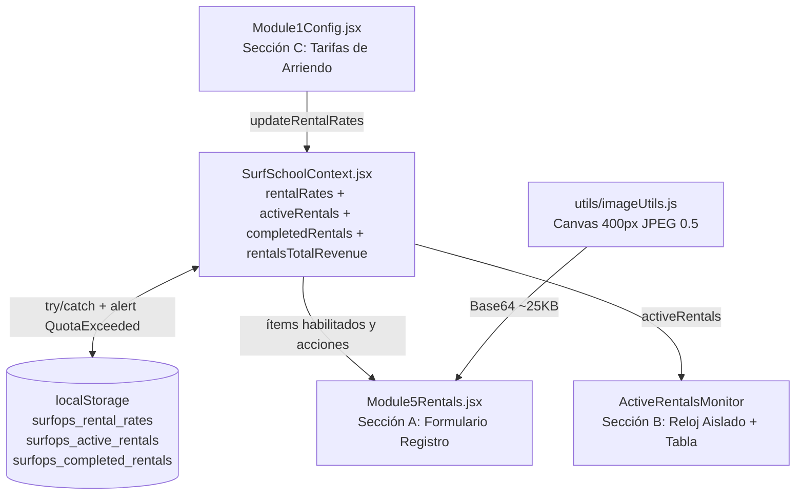

# SurfOp ERP — Configuración Centralizada de Tarifas de Arriendo (Módulo 01) y Operaciones de Arriendo (Módulo 05)

*   **Autor:** josealfaro7
*   **Estado:** Aprobado (Approved — EGM Resolved)
*   **Fecha:** 2026-11-08

--------------------------------------------------------------------------------

## Overview

Este documento de diseño extiende la aplicación web SurfOp ERP (`POISSON`) incorporando la configuración centralizada de tarifas de arriendo de equipamiento en [Module1Config.jsx](./src/components/Module1Config.jsx) y un nuevo módulo operativo dedicado ([Module5Rentals.jsx](./src/components/Module5Rentals.jsx)) accesible mediante una quinta pestaña de navegación (`05 · 🏄‍♂️ Arriendos`) en [App.jsx](./src/App.jsx).

El administrador puede configurar el precio por hora en pesos chilenos (CLP) y habilitar o deshabilitar cuatro ítems de equipamiento (`tabla_surf`, `traje_surf`, `bodyboard`, `aletas`) dentro del Módulo 01 (protegido por el PIN de 4 dígitos `0000`). En el Módulo 05, recepción puede registrar arriendos activos exigiendo la captura comprimida en Base64 (`maxWidth = 400`, `quality = 0.5`) de la foto del Carnet de Identidad del cliente, monitorear en tiempo real los arriendos en curso con un subcomponente aislado de reloj (`ActiveRentalsMonitor`), inspeccionar la foto del documento en un modal y registrar la devolución del equipamiento hacia un historial de completados persistido en `localStorage`.

## The Problem

Las escuelas de surf arriendan tablas, trajes de neopreno, bodyboards y aletas a clientes por hora de manera independiente a las clases con instructor. Actualmente, SurfOp ERP solo gestiona clases de surf en [SurfSchoolContext.jsx](./src/context/SurfSchoolContext.jsx), dejando la operación de arriendos sin control sistemático. Esto genera tres problemas operativos:

1.  **Inconsistencia de precios en recepción**: El personal de recepción no cuenta con un tarifario por hora centralizado, protegido por PIN, que calcule automáticamente el cobro según cantidad y horas o bloquee equipamiento fuera de stock.
2.  **Riesgo de pérdida o robo de equipamiento**: Entregar tablas y trajes sin registrar datos de contacto del arrendatario, contacto de emergencia y una fotografía de su Carnet de Identidad expone a la escuela a pérdidas de material.
3.  **Falta de control de horas de devolución**: Sin un monitor en vivo que compare `check_in + hours` contra el reloj actual, el personal pierde visibilidad sobre qué arriendos ya superaron su hora límite de entrega.

## Goals

*   **G1 — Configuración Centralizada de Tarifas de Arriendo (Módulo 01)**: Agregar la Sección C (`Tarifas de Arriendo (Equipamiento)`) en [Module1Config.jsx](./src/components/Module1Config.jsx) para los cuatro ítems (`tabla_surf`, `traje_surf`, `bodyboard`, `aletas`), cada uno con un campo numérico `Precio por Hora (CLP)` (`pricePerHour >= 0`) y un selector de estado (`Habilitado` / `Deshabilitado`), persistidos bajo la clave `surfops_rental_rates` en `localStorage` y expuestos en [SurfSchoolContext.jsx](./src/context/SurfSchoolContext.jsx).
*   **G2 — Formulario de Registro de Arriendos en Dos Columnas (Módulo 05, Sección A)**: Crear [Module5Rentals.jsx](./src/components/Module5Rentals.jsx) con una columna izquierda para los datos del arriendo (selector de ítems habilitados, cantidad numérica `>= 1`, horas de arriendo `1..12`, hora de ingreso `HH:MM` autocompletada y editable, descuento manual en CLP y bloque destacado `Subtotal (Tarifa x Cantidad x Horas) - Descuento = TOTAL A PAGAR`) y una columna derecha para los datos del cliente (`name`, `email`, `phone`, `emergency_contact` y carga obligatoria de foto de Carnet de Identidad con vista previa y advertencia de seguridad).
*   **G3 — Compresión Agresiva de Imagen en Base64 Segura para `localStorage` (`maxWidth = 400`, `quality = 0.5`)**: Aislar la compresión DOM/Canvas en `./src/utils/imageUtils.js` (`compressImageFileToBase64(file, 400, 0.5)`) y proteger las escrituras en `localStorage` con un bloque `try/catch` que emita una alerta visible al usuario si se excede la cuota de 5 MB.
*   **G4 — Monitor de Arriendos Activos con Reloj Aislado y Resumen Financiero Derivado**: Renderizar la tabla de `"Arriendos en Curso"` en un subcomponente dedicado (`ActiveRentalsMonitor`) que aísle su `setInterval`, reutilizando `timeToMinutes` y `addMinutesToTime(checkInTime, hours * 60)` de [calculations.js](./src/utils/calculations.js), y exponer `rentalsTotalRevenue` en [SurfSchoolContext.jsx](./src/context/SurfSchoolContext.jsx) para futura integración con el Cierre Diario (Módulo 04).

## Non-Goals

*   **NG1 — Almacenamiento en la Nube (Supabase Storage)**: El envío de imágenes a buckets remotos queda fuera del alcance de esta iteración; se utiliza Base64 comprimido en `localStorage` como almacenamiento local de prueba.
*   **NG2 — Control de Inventario Físico por Código de Barras / Número de Serie**: No se rastrean unidades individuales por talla o número de serie; el arriendo opera por categoría de ítem y cantidad.
*   **NG3 — Pago de Comisión a Instructores por Arriendos**: Los arriendos de equipamiento no asignan instructores de la Fila Virtual del Módulo 02 ni generan honorarios de staff (`instructorPay = 0`).

## Critical User Journeys (CUJs)

### CUJ 1: Administrador Actualiza Tarifas de Arriendo y Deshabilita un Ítem

*   **Given (Dado que)**: El administrador entra al Módulo 01 (`Configuración`) y desbloquea el panel ingresando el PIN `0000`.
*   **When (Cuando)**: Configura `Tabla de Surf` en `$8.000 / hr` (Habilitado), `Traje de Surf` en `$5.000 / hr` (Habilitado), `Bodyboard` en `$5.000 / hr` (Habilitado), cambia `Aletas` a `Deshabilitado` y presiona `Guardar Configuración`.
*   **Then (Entonces)**: Se actualiza `surfops_rental_rates` en `localStorage` y en `SurfSchoolContext`; al abrir el Módulo 05 (`🏄‍♂️ Arriendos`), el selector de equipamiento muestra únicamente los tres ítems habilitados (`Tabla de Surf`, `Traje de Surf`, `Bodyboard`).

### CUJ 2: Recepción Registra un Nuevo Arriendo con Foto Obligatoria de Carnet

*   **Given (Dado que)**: Recepción abre la pestaña `05 · 🏄‍♂️ Arriendos` a las `11:30`.
*   **When (Cuando)**: Selecciona `Tabla de Surf` (`$8.000 / hr`), ingresa `Cantidad = 2`, `Horas = 2`, `Hora de Ingreso = 11:30`, `Descuento = 1000`, completa los datos del cliente (`name`, `email`, `phone`, `emergency_contact`), sube la foto del Carnet de Identidad y hace clic en `Registrar Arriendo`.
*   **Then (Entonces)**: El sistema calcula `Subtotal = $32.000`, `Descuento = $1.000`, `TOTAL A PAGAR = $31.000`, comprime la foto (`maxWidth = 400`, `quality = 0.5`), guarda el arriendo en `surfops_active_rentals` con `estimatedReturnTime = addMinutesToTime("11:30", 2 * 60)` (`"13:30"`), limpia el formulario e incorpora la fila en la Sección B (`Arriendos en Curso`).

### CUJ 3: Monitoreo de Arriendo Atrasado y Recepción de Devolución

*   **Given (Dado que)**: Existe un arriendo activo en `surfops_active_rentals` con `checkInTime = "10:00"`, `hours = 1` y `estimatedReturnTime = "11:00"`, siendo las `11:25` en el reloj del sistema.
*   **When (Cuando)**: Recepción revisa la Sección B (`Arriendos en Curso`), abre el modal de verificación de Foto de Carnet con el botón de vista previa y luego presiona `Devolución Recibida` cuando el cliente entrega el equipo.
*   **Then (Entonces)**: Mientras está activo a las `11:25`, la fila muestra el badge rojo parpadeante (`ATRASADO`). Al presionar `Devolución Recibida`, el registro sale de `surfops_active_rentals`, pasa a `surfops_completed_rentals` con la hora real de entrega y el ingreso queda contabilizado en `rentalsTotalRevenue`.

## Technical Plan (Architecture)

### Flujo de Datos del Sistema (Post-Resolución EGM)

### Resoluciones Arquitectónicas Aplicadas (`zoom_out_report.md`)

1.  **Reutilización de Aritmética de Tiempo ([1] y [6])**: Se reutilizan `timeToMinutes` y `addMinutesToTime(checkInTime, hours * 60)` de [calculations.js](./src/utils/calculations.js). El `setInterval` para evaluar `timeToMinutes(currentHHMM) > timeToMinutes(rental.estimatedReturnTime)` vive exclusivamente dentro del subcomponente `ActiveRentalsMonitor` para no re-renderizar el formulario de la Sección A.
2.  **Separación de Concerns ([2])**: [calculations.js](./src/utils/calculations.js) permanece 100% puro y síncrono (`calculateRentalTotals`). La lógica asíncrona de DOM/Canvas (`compressImageFileToBase64`) se aloja en `./src/utils/imageUtils.js`.
3.  **Protección de Memoria e Inspector ([3] y [4])**: Compresión agresiva (`maxWidth = 400`, `quality = 0.5`), `try/catch` con `window.alert` explícito ante `QuotaExceededError` y truncado de `"idPhotoBase64": "[IMAGE DATA TRUNCATED]"` en el Inspector de Memoria de [App.jsx](./src/App.jsx).
4.  **Resumen Financiero Derivado ([5])**: [SurfSchoolContext.jsx](./src/context/SurfSchoolContext.jsx) calcula y expone `rentalsTotalRevenue` sumando el `finalTotal` de los arriendos del día (`activeRentals` + `completedRentals`) sin alterar las métricas de instructores.

--------------------------------------------------------------------------------

## Detailed Implementation Plan

### Target Files to Create/Modify

#### 1. [`./src/utils/calculations.js`](./src/utils/calculations.js) (Modify)

*   **Type / Scope**: Módulo de funciones puras de cálculo.
*   **Proposed Changes**:
    *   Reutilizar `timeToMinutes` y `addMinutesToTime(timeStr, minutesToAdd)` existentes.
    *   Agregar la función pura `calculateRentalTotals(pricePerHour, quantity, hours, discount)` que retorna `{ subtotal, discount, finalTotal }`.

#### 2. `./src/utils/imageUtils.js` (Create)

*   **Type / Scope**: Utilidad del navegador para compresión de imagen en `<canvas>`.
*   **Proposed Changes**:
    *   Exportar `compressImageFileToBase64(file, maxWidth = 400, quality = 0.5)` que escala proporcionalmente la imagen a un máximo de `400px` de ancho y exporta `canvas.toDataURL('image/jpeg', 0.5)`.

#### 3. [`./src/context/SurfSchoolContext.jsx`](./src/context/SurfSchoolContext.jsx) (Modify)

*   **Type / Scope**: Contexto global y persistencia protegida en `localStorage`.
*   **Proposed Changes**:
    *   Definir `INITIAL_RENTAL_RATES` (`tabla_surf`, `traje_surf`, `bodyboard`, `aletas`).
    *   Gestionar `rentalRates` (`surfops_rental_rates`), `activeRentals` (`surfops_active_rentals`) y `completedRentals` (`surfops_completed_rentals`) con un helper `safeSaveToLocalStorage(key, data)` que capture `QuotaExceededError` y dispare una alerta visible.
    *   En `addRental`, calcular `estimatedReturnTime = addMinutesToTime(checkInTime, Number(hours) * 60)`.
    *   Calcular con `useMemo` el derivado `rentalsTotalRevenue` sumando el `finalTotal` de `activeRentals` y `completedRentals`.

#### 4. [`./src/components/Module1Config.jsx`](./src/components/Module1Config.jsx) (Modify)

*   **Type / Scope**: Componente React (Módulo 01 — Configuración).
*   **Proposed Changes**:
    *   Agregar la tarjeta **`C. Tarifas de Arriendo (Equipamiento)`** con input numérico `Precio por Hora (CLP)` y switch/checkbox `Habilitado` / `Deshabilitado` para los 4 ítems (`tabla_surf`, `traje_surf`, `bodyboard`, `aletas`), guardando en `surfops_rental_rates`.

#### 5. `./src/components/Module5Rentals.jsx` (Create)

*   **Type / Scope**: Componente React (Módulo 05 — Operaciones de Arriendo y Monitor Aislado).
*   **Proposed Changes**:
    *   Implementar **Sección A (Formulario de Registro en 2 columnas)** y **Sección B (`ActiveRentalsMonitor` con reloj aislado, badge verde/rojo parpadeante, modal de foto de carnet y botón `"Devolución Recibida"` + historial de completados)**.

#### 6. [`./src/App.jsx`](./src/App.jsx) (Modify)

*   **Type / Scope**: Navegación principal e Inspector de Memoria.
*   **Proposed Changes**:
    *   Agregar la pestaña `05` (`🏄‍♂️ Arriendos`) en la barra de navegación (`lg:grid-cols-5`).
    *   En el Inspector de Memoria (`showStateInspector`), mostrar `activeRentals` reemplazando `idPhotoBase64` por `"[IMAGE DATA TRUNCATED]"` para no colapsar la vista.

--------------------------------------------------------------------------------

*Drafted & Resolved with EGM*
